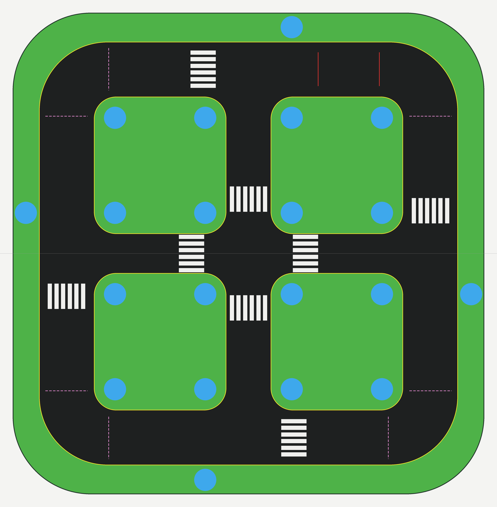

# track-digital-twin

라즈베리파이 자율주행 자동차 실습에 쓰는 '田'자형 도시 맵 트랙 매트를 시뮬레이터로 옮기기 위한 디지털 트윈 도면입니다.
줄자로 잰 치수와, 트랙 사진을 원근 보정해 위에서 본 모습으로 편 뒤 잰 치수로 만들었습니다.



## Isaac Sim 실행·학습 코드

Ubuntu · RTX 5070 · Isaac Sim 5.1을 대상으로 트랙, 4륜 스키드 스티어 차량, 카메라,
표지판·신호등 장면과 데이터 수집·학습 코드를 추가했습니다.

- [RTX 노트북 실행 안내](docs/rtx_ubuntu.md): 수동 주행 → 교사 주행 → 무작위화 데이터 수집 → CNN/검출기 학습 → 보지 않은 조건 평가
- [녹음·이미지 규칙 대조](docs/mission_rules.md): 분홍선 이전 실행, 중복 감점, 안쪽 횡단보도, 신호·방향 규칙
- [녹음 전사와 정리](docs/recording/README.md): 시간 표시 전사, 불명확한 구간, 자료별 근거
- [차량·카메라 설정](configs/rtx.json): 실측값과 추정값의 출처, 난수화 범위
- [미션 제어 통합](docs/autonomy.md): ONNX 검출·추적·거리 추정·교차로 제어·완료 집계

```bash
export ISAAC_PY="$HOME/isaacsim/python.sh"
"$ISAAC_PY" -m pip install -r requirements-sim.txt
"$ISAAC_PY" run_sim.py --check
"$ISAAC_PY" run_sim.py --mode manual --seed 1
"$ISAAC_PY" run_sim.py --mode expert --duration 90 --record
```

차선 주행에 더해 `--missions --detector ...`로 검출·추적·거리 추정·교차로 제어를 연결합니다.
미션 제어는 RGB, 측정 바퀴 속도와 트랙 지도를 사용하며 시뮬레이터 위치/bbox 정답은 사용하지 않습니다.
차선/검출 가중치 학습과 카메라·바퀴 보정, RTX에서의 실제 주행 검증은 별도로 진행해야 합니다.
코드·USD 구조 검사는 수행하지만 실제 RTX 렌더링·PhysX 주행과 학습된 모델의 강건성을 검증한 상태는 아닙니다.
원본 녹음, 사람이 나온 사진, 교재 코드와 학습 결과물은 공개 저장소에 포함하지 않습니다.

## 파일

| 파일 | 내용 |
|---|---|
| `make_track.py` | 도면 생성기. 치수를 바꾸고 다시 실행하면 아래 두 파일이 새로 만들어집니다 |
| `track_texture.png` | 위에서 본 매트 이미지. 1px = 1mm, 2355 × 2400 (흰 테두리 포함 2.355m × 2.4m) |
| `track_layout.json` | 도로 중심선, 교차로 5곳, 횡단보도 8개, 노면 표시 9개, 소품 자리(파란 원) 20곳의 좌표 |

## 실행

```bash
pip install pillow
python3 make_track.py
```

## 좌표계 (`track_layout.json`)

- 단위 m, 원점은 매트 중심, x = 동(이미지 오른쪽), y = 북(이미지 위쪽)
- 북쪽은 빨간 실선 두 개가 있는 도로입니다. 매트 이음매는 동서 방향 가운데 도로 한가운데를 지납니다.
- 시뮬레이터에서 2.355m(동서) × 2.4m(남북) 평면에 `track_texture.png`를 입히면 JSON 좌표와 맞습니다.

## 치수와 출처

| 항목 | 값 | 출처 |
|---|---|---|
| 인쇄 영역 (초록 끝 ~ 초록 끝) | 223.5(동서) × 228(남북) cm | 줄자. 짧은 쪽이 동서라는 판단은 사진 |
| 바깥 순환로 폭 | 26 cm | 줄자 |
| 가운데 도로 (동서) | 18.5 cm | 줄자 |
| 가운데 도로 (남북) | 21 cm | 사진 (약 20.7 cm) |
| 블록 | 62.75(동서) × 65(남북) cm | 남북은 줄자, 동서는 나머지로 계산 (사진 약 63.6 cm) |
| 바깥 초록 띠 | 동서 끝 12.5 cm, 남북 끝 13.75 cm | 동서 끝은 줄자, 남북 끝은 계산 |
| 횡단보도 흰 줄 | 폭 2 cm, 간격 1.15 cm, 길이 12 cm, 6줄 | 줄자, 줄 수는 사진 |
| 모서리 반경 | 블록 10.5 cm, 순환로 바깥 32.5 cm, 초록 바깥 37 cm | 사진 |
| 흰 테두리 | 6 cm | 추정 |

- 사진 치수는 트랙 사진 한 장을 블록 4개의 중심 기준으로 원근 보정(2mm/px)해서 쟀습니다. 오차는 매트 안쪽 ±1~2cm, 가장자리 ±2~4cm입니다.
- 모서리 반경은 노란선 픽셀에 원을 맞춰 구했습니다. 블록 모서리 5곳은 104~107mm, 순환로 바깥 모서리 3곳은 322~333mm로 나왔습니다.
- 생성한 도면을 원근 보정한 사진과 겹쳐서 블록, 가운데 도로, 횡단보도, 파란 원, 노면 표시 위치를 확인했습니다.
- `make_track.py` 안의 치수마다 `[측정]` / `[사진]` / `[추정]` 표시가 붙어 있습니다.

## 아직 확인이 필요한 것

- 남북 방향 가운데 도로 폭 (사진으로만 잼)
- 블록 동서 폭 (계산값 62.75 cm). 63 cm 근처가 나오면 짧은 쪽이 동서라는 판단이 맞습니다.
- 흰 테두리 폭

## 대상 차량

- 다두이노 RaspberryPi AI CAR v14 (Raspberry Pi 5), 길이 25cm, 폭 16cm(바퀴 포함), 스키드 스티어
- 차 폭 기준 좌우 여유: 바깥 순환로 5cm, 동서 가운데 도로 1.25cm, 남북 가운데 도로 2.5cm
