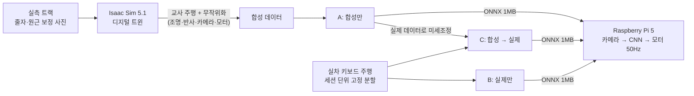
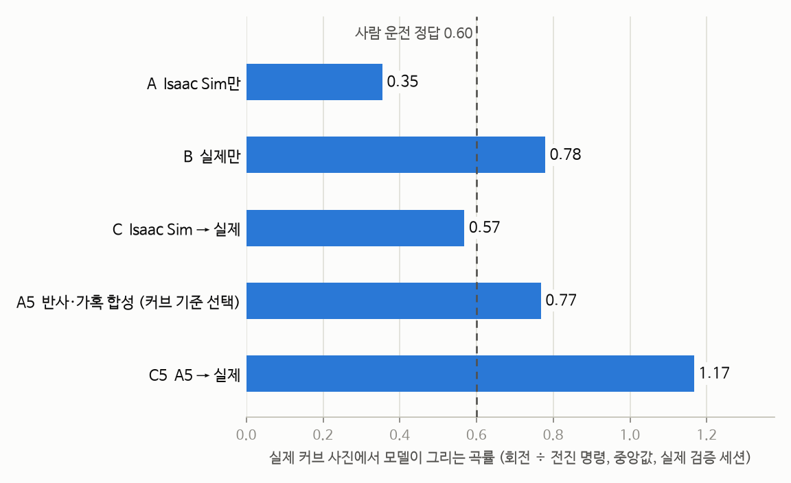
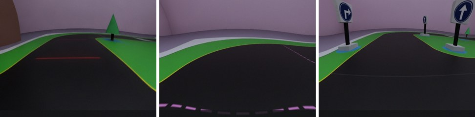
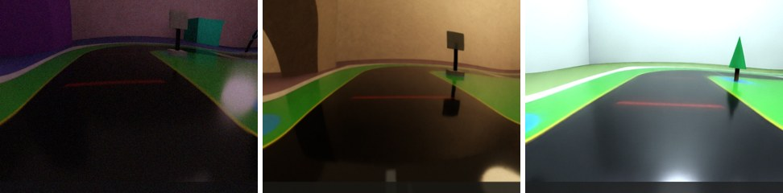

# track-digital-twin

**Sim-to-Real Gap 극복: Isaac Sim 디지털 트윈에서 배운 카메라 자율주행을 라즈베리파이 실차로 옮기기**

라즈베리파이 자율주행 실습 트랙을 NVIDIA Isaac Sim 5.1 안에 그대로 만들고(디지털 트윈),
가상 트랙에서 카메라 영상만 보고 운전하는 CNN을 학습한 뒤, 같은 모델을 Raspberry Pi 5 실차에서 돌립니다.
이 저장소의 핵심 질문은 하나입니다. **"시뮬레이터에서 잘 달리는 모델이 왜 실차에서는 못 달리고, 어떻게 메우는가?"**

| | Isaac Sim | 실제 트랙 (Pi 5, 2026-10-31) |
|---|---|---|
| 합성 데이터만으로 학습한 모델 A | 바깥 경로 **10/10 두 바퀴 완주** | 커브 4곳 **모두 이탈** |
| 같은 모델, 가혹 조건 (밝기·반사·모터 차이) | **0/5** (1m 안에 이탈) | — |

가상에서 10/10이던 모델이 실차에서 0이 된 것이 출발점입니다. 아래는 그 간극(gap)을 하나씩 찾아 측정하고
고친 기록입니다.

## 파이프라인



모든 모델은 같은 행동 규약(`normalized_linear_angular_v1`: 전진·회전 두 값)을 쓰기 때문에,
모델 파일만 바꾸면 시뮬레이터와 실차에서 똑같이 실행됩니다. Pi는 Isaac Sim 없이 1MB짜리 ONNX와
카메라·모터 코드만 돌립니다(촬영→모터 지연 p50 34–38ms).

## Gap 진단과 대응

| Gap | 증거 | 대응 | 상태 |
|---|---|---|---|
| **외관: 조명 반사·밝기** | 실차 이탈 지점이 모두 매트에 조명이 비치는 왼쪽 위 모서리. 모델 A는 가혹 조건 0/5 | 낮고 먼 광원(창문·먼 조명) + 반짝이는 매트 + 밝기 0.5–1.6배 + 잡음을 학습 무작위화에 추가 (`--harsh`) | 🔄 v5 수집 완료(80회), 가혹 평가는 아직 0–1/5 |
| **구동: 속도 습관** | A는 항상 최대 전진(0.97–0.99)을 내서 실차에서 B의 약 2배 속도 | 가상 교사의 최고 속도를 사람 운전 수준(55%)으로 (`--teacher-speed-scale`) | ✅ v5 전진 오차 0.52 → 0.38 |
| **구동: 스키드 회전** | PhysX 강체 바퀴는 제자리 회전을 명령의 3–9%만 재현 | 실측 회전 효율 η≈0.43을 넣은 운동학 스키드 모델로 구동 | ✅ |
| **형상: 트랙 치수** | 줄자 실측에서 동쪽 바깥 도로만 24cm (도면 26cm) | 도면 재생성, 나머지 좌표는 그대로 | ✅ |
| **카메라: 렌즈·각도** | 팀 체커보드 보정의 5계수 왜곡이 가장자리에서 역변환 불가 | 단조 2계수로 재적합, 실측 높이 7cm·기울기 23°, 좌우 무작위화 | ✅ |
| **평가: 지표의 함정** | 세 모델의 전체 조향 오차는 비슷(0.17)한데 실차 결과는 다름. 회전 값만 보면 셋 다 사람의 절반이지만, 차가 그리는 **곡률(회전÷전진)**로 보면 B·C는 사람과 비슷하고 A만 0.35로 덜 꺾음 (아래 그래프) | 직선·커브 분리와 곡률 지표(`by_label`). 커브 오차로 회차를 고르면 덜 학습된 1회차가 뽑혀(A5) 합성 검증 기준으로 재학습 | ✅ 도구 / 🔄 A5b 재학습 중 |
| **하드웨어: Pi 발열·전원** | 다른 프로세스가 CPU를 쓰는 동안(84–86°C) 모터 시작 직후 Pi가 4번 꺼짐 | 출발 전 온도·부하 확인, 전압·온도 1초 기록 | ✅ 운영 규칙 |

<picture>
  <source media="(prefers-color-scheme: dark)" srcset="docs/images/curve_steering_dark.png">
  
</picture>

실제 검증 세션(반시계방향 2,966장 중 커브 581장)에서 모델이 커브에서 그리는 곡률입니다. 차가 그리는 길은
회전 값 하나가 아니라 **회전÷전진**으로 정해집니다. B·C는 커브에서 속도를 줄이며 꺾어 사람과 비슷한 곡률을
그리고, 합성만으로 배운 A는 0.35로 덜 꺾습니다. A가 실차 커브에서 직진 이탈한 것과 맞습니다.
반사·가혹 합성으로 다시 학습한 A5는 0.77로 이 간극이 줄었습니다. 처음에는 회전 값만 비교해서
"세 모델 모두 절반만 꺾는다"고 잘못 판단했고, 그 뒤 곡률 지표로 바로잡았습니다.

### 가상 카메라 장면: 기존 → 반사·가혹 무작위화

| 기존 학습 장면 (v4b) |
|---|
|  |
| **반사·가혹 무작위화 (v5, `--harsh`)**: 도로에 비친 광원, 번들거리는 매트, 어둡거나 밝은 노출 |
|  |

차량 카메라는 바닥에서 7cm 높이에서 23° 아래를 봅니다. 그래서 천장 조명의 반사는 카메라에 들어오지 않고,
**낮고 먼 광원**의 반사만 도로 위에 보입니다. 처음에는 천장 조명을 넣었다가 반사가 보이지 않아,
광원 위치를 이렇게 바꿨습니다.

## 실차 A/B/C 결과 (2026-10-31)

| 모델 | 학습 데이터 | 실제 검증 조향 오차 (전체 / 직선 / 커브) | 커브 곡률 (정답 0.60) | Isaac Sim 가혹 조건 | 실차 |
|---|---|---|---|---|---|
| A `lane-v4b` | 합성만 | 0.177 / 0.123 / 0.399 | 0.35 | 0/5 | 커브 4곳 모두 직진 이탈 |
| B `lane-real-B` | 실제만 (6,393장) | 0.176 / 0.128 / 0.374 | 0.78 | — | 직선 20초·큰길 커브 40초 이탈 0, 한 바퀴는 반사 구간에서 실패 |
| C `lane-real-C` | 합성 → 실제 미세조정 | 0.172 / 0.113 / 0.414 | 0.57 | — | 큰길 커브 성공(A는 실패), 좁은 도로·반사 구간 이탈 |
| A5 `lane-v5` | 반사·가혹 합성(v5), 커브 오차로 1회차 선택 | 0.204 / 0.173 / 0.331 | 0.77 | 0/5 | 미시험 |
| C5 `lane-real-C5` | A5 → 실제 미세조정 | 0.263 / 0.252 / 0.310 | 1.17 (과함) | 1/5 (90초 이탈 0) | 미시험 |

A5는 커브 곡률이 크게 좋아졌지만, 커브 오차로 회차를 고르다 **덜 학습된 1회차**가 선택되어 직선이 나빠졌고
Isaac Sim 일반 평가에서도 10회 중 4회만 이탈 없이 90초를 달렸습니다. 같은 v5 데이터로 합성 검증 기준
회차를 고른 A5b·C5b를 학습·평가하는 중입니다.

실제 데이터는 세션 단위로 고정 분할했고(train 3세션, validation 반시계 1세션, test 어두운 조명 1세션),
test는 최종 1회만 씁니다(아직 미사용). 자세한 수치는 [검증 기록](docs/validation.md)에 있습니다.

## 빠른 시작

```bash
# Isaac Sim (Ubuntu, RTX GPU) — 설치는 docs/rtx_ubuntu.md
export ISAAC_PY="$HOME/isaacsim_env/bin/python"
"$ISAAC_PY" run_sim.py --check
python3 run_batch.py --python "$ISAAC_PY" --mode collect --count 30 --harsh \
    --teacher-speed-scale 0.55 --output outputs/train-v5          # 반사·가혹 무작위화 수집

# 학습 (별도 venv, Isaac의 torch를 건드리지 않음)
python train_policy.py outputs/train-v5 --real-manifest outputs/real/manifest-1031.json \
    --train-on synthetic --select-on real --select-metric turning --output models/lane-v5
python evaluate_lane_offline.py --split validation --real-manifest outputs/real/manifest-1031.json \
    models/lane-v5/policy.onnx                                     # 직선·커브 분리 점수

# Raspberry Pi 5 실차
.venv-pi/bin/python run_vehicle.py --policy models/lane-real-C/policy.onnx --motors gpio \
    --flip180 --calibration configs/real_car.json --speed-scale 0.5 --duration 180
```

## 문서

| 문서 | 내용 |
|---|---|
| [검증 기록](docs/validation.md) | RTX 실행, 폐루프 평가, Pi 지연, 실차 A/B/C 결과 |
| [실차 계획과 구현 상태](docs/real_vehicle_plan.md) | 실제 데이터 분리·미세조정, 실차 추론/제어 분리, Pi 측정 |
| [Ubuntu·RTX 실행 안내](docs/rtx_ubuntu.md) | 설치 → 교사 주행 → 수집 → 학습 → 평가 |
| [현장 체크리스트](docs/field_session.md) | 카메라·바퀴 실측, 운동 보정, 주행 녹화, Pi 측정 |
| [미션 규칙](docs/mission_rules.md) | 표지판별 행동·무시 표, 분홍선 이전 실행, 감점 규칙 |
| [미션 제어](docs/autonomy.md) | 검출·추적·거리 추정·교차로 제어 |
| [트랙 도면](docs/track.md) | 치수와 출처, 좌표계, 대상 차량 |
| [시작 프롬프트](START_HERE_PROMPT.md) · [인계 프롬프트](RTX_HANDOFF_PROMPT.md) | 새 RTX 노트북에서 코딩 에이전트로 clone부터 이어서 진행 |
| [차량·카메라 설정](configs/rtx.json) | 실측값·추정값 출처, 무작위화 범위 |

## 공개 범위

원본 녹음, 사람이 나온 사진, 실제 주행 영상·사진, 교재 코드, 학습된 가중치와 데이터는 이 공개 저장소에 넣지 않습니다.
README의 장면 이미지는 모두 Isaac Sim 합성 이미지이고, 그래프는 평가 로그의 요약 수치입니다(`tools/make_sim2real_figures.py`).
